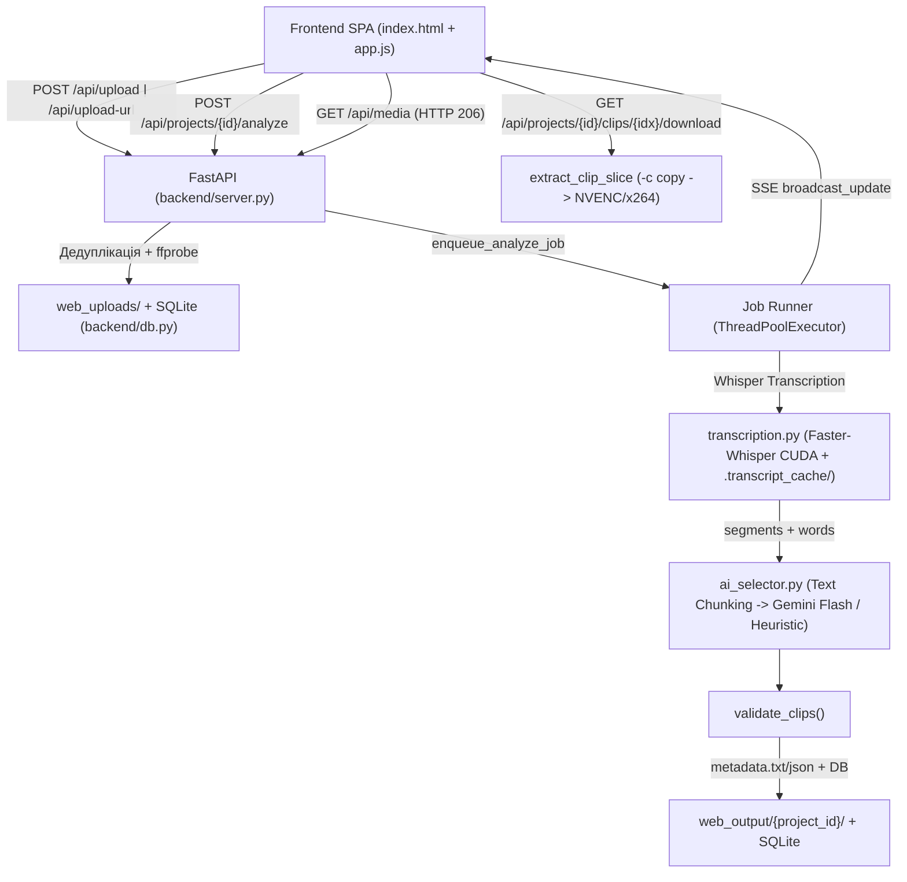

# ARCHITECTURE.md — AI Video Moments Analyzer Studio

> **Останнє оновлення:** 2026-11-18  
> **Відповідальна роль:** `[Architect]` Головний Архітектор  
> **Статус:** Зафіксовано за результатами первинного повного аудиту (Етап 1)

---

## 1. Призначення системи

**AI Video Moments Analyzer Studio** — локальний веб-застосунок та CLI-інструмент для аналізу довгих відео (подкастів, інтерв'ю, лекцій), виявлення найсильніших вірусних фрагментів (таймкоди, заголовки, хуки, Virality Score, описи, хештеги) та миттєвої нарізки обраних кліпів (lossless stream-copy / hardware-accelerated fallback) без важкого вертикального 9:16 рендерингу.

---

## 2. Технологічний стек

| Шар | Технології | Примітки |
|---|---|---|
| **Runtime** | Python 3.12 (`win32`, `.venv`) | Windows-first, обов'язкова UTF-8 конфігурація консолі |
| **Web Backend** | FastAPI (`>=0.110`), Uvicorn (`>=0.30`), Pydantic v2 (`>=2.6`) | REST API + SSE (`StreamingResponse`) + HTTP 206 Range Streaming |
| **Database** | SQLite3 (`studio_data.db`) | WAL mode, `PRAGMA foreign_keys = ON`, 3 таблиці (`projects`, `candidate_clips`, `jobs`) |
| **AI / Cloud Engine** | `google-genai` (`>=1.16.0`) | Gemini File API (мультимодальний аудіо-аналіз вікнами) + текстовий аналіз із multi-model fallback |
| **AI / Local STT** | `faster-whisper` (`>=1.0.3`, CTranslate2), `av`, `nvidia-cublas-cu12`, `nvidia-cudnn-cu12` | Локальна транскрипція + SHA-256 дисковий кеш (`.transcript_cache/`) |
| **Media & Ingestion** | `ffmpeg`, `ffprobe`, `yt-dlp` (`>=2024.11.4`) | Екстракція аудіо, нарізка MP4, генерація прев'ю, завантаження за URL (без `opencv-python`) |
| **Frontend** | Vanilla HTML5 / CSS3 / ES6+ (`frontend/`) | Без збірника; тема «Linear Dark Minimal»; EventSource (SSE); безпечний DOM (`addEventListener`) |
| **QA & Testing** | `pytest`, `pytest-cov`, `review_agent.py` | 150 тестів, покриття 87%, посилений статичний security/XSS/DB лінтер |

---

## 3. Структура директорій та карта модулів

```text
c:\short_agent\
├── .antigravity/                # Постійна пам'ять Multi-Agent Dev Team (ARCHITECTURE, STATE, DECISIONS)
├── .agents/                     # Синхронізовані правила v3.0 та скіл code-auditor
├── backend/                     # Веб-шар (FastAPI + SQLite + фонові воркери)
│   ├── server.py                # REST API, SSE stream, HTTP 206 media streaming, static SPA mount
│   ├── job_runner.py            # ThreadPoolExecutor (2 воркери), SSE pub/sub, dual-engine оркестрація
│   └── db.py                    # SQLite DAL (projects, candidate_clips, jobs, UPSERT, WAL)
├── frontend/                    # SPA інтерфейс без фреймворків
│   ├── index.html               # Основна розмітка (History, Step 1 Upload/URL/Engine, Step 2 Player+Moments)
│   ├── js/app.js                # Клієнтський контролер, EventSource, slice downloader, clipboard
│   └── css/style.css            # Стилі (Linear Dark Minimal)
├── tests/                       # 14 тестових модулів (150 тестів, 87% покриття) + conftest.py
├── core.py                      # Unified Facade (реекспорт публічного API ядра)
├── ai_selector.py               # Текстовий Gemini-селектор, chunking >100k символів, JSON парсер, евристика
├── transcription.py             # Faster-Whisper/OpenAI Whisper пайплайн + SHA-256 кешування
├── state.py                     # AppState singleton (thread-safe double-checked locking: Whisper, Gemini, GPU)
├── config_loader.py             # Завантаження config.yaml + пошук GEMINI_API_KEY (.env / env)
├── config_schema.py             # Pydantic v2 валідація конфігурації (AppConfig)
├── constants.py                 # StrEnum-константи (FilterMode, VideoLanguage) та резолвер
├── logger.py                    # Структуроване логування (text / JSON, RotatingFileHandler 5 MB × 3)
├── utils.py                     # FFmpeg/ffprobe утиліти, yt-dlp + SSRF/traversal guard, дедуплікація, CTranslate2 CUDA probing
├── run_studio.py                # Точка входу Web Studio (Uvicorn 127.0.0.1:8000 + авто-браузер)
├── repurpose_agent.py           # CLI точка входу (локальний Whisper + Gemini -> metadata.txt/json)
├── review_agent.py              # Автоматичний QA-аудитор + pytest runner + E2E smoke check
├── config.yaml                  # Конфігурація моделей Whisper/Gemini, кліпів, кешу, логів
└── studio_data.db               # Продакшн SQLite база (в .gitignore)
```

---

## 4. Архітектура потоків даних (Data Flow)



---

## 5. Схема бази даних (SQLite)

- **`projects`**: `id (PK)`, `title`, `source_path`, `duration`, `status (uploaded|analyzing|ready|failed)`, `created_at`, `updated_at`
- **`candidate_clips`**: `id (PK)`, `project_id (FK CASCADE)`, `clip_index`, `start_sec`, `end_sec`, `duration`, `virality_score`, `title`, `hook_text`, `reason`, `caption`, `hashtags (JSON)`, `is_selected`
- **`jobs`**: `id (PK)`, `project_id (FK CASCADE)`, `job_type`, `status (queued|running|completed|failed)`, `progress`, `message`, `error`, `created_at`, `updated_at`

---

## 6. Погоджені інженерні угоди (Code Conventions & Guardrails)

1. **Безпека та межі файлової системи**:
   - Усі файлові ендпоїнти та `download_from_url` повинні перевіряти приналежність шляху через `Path(target).resolve().is_relative_to(Path(allowed_root).resolve())` (жодних `str.startswith()`).
   - `project_id` в URL має проходити сувору валідацію (дозволені лише безпечні символи, без path separators та `..`).
   - Усі завантаження через `yt-dlp` обов'язково використовують `--` роздільник і валідацію схеми `http/https` + захист від SSRF (заборона приватних/loopback IP).
   - Жодних захардкоджених API-ключів у репозиторії; лише `.env` / змінні оточення.
2. **Конкурентність та продуктивність**:
   - Не викликати важкі синхронні операції (`subprocess`, файловий I/O, GPU probing) в `async def` без `asyncio.to_thread()` та кешування через `AppState`.
   - Замість глобальних блокувань на весь сервер використовувати гранулярні per-resource lock'и (наприклад, per-clip-path lock для нарізки MP4).
   - Усі `subprocess.run()` зобов'язані мати явний `timeout`.
3. **Windows-сумісність**:
   - Усі точки входу викликають `setup_console_encoding()` (UTF-8 для `stdout`/`stderr`, захист від `cp1251`).
   - Робота зі шляхами лише через `pathlib.Path` або `os.path.join`.
4. **База даних**:
   - Тільки параметризовані SQL-запити (`?`), `PRAGMA foreign_keys = ON`, `WAL` mode.
   - Уникати `INSERT OR REPLACE` на батьківських таблицях із `ON DELETE CASCADE` — використовувати `INSERT ... ON CONFLICT(id) DO UPDATE`.
   - Не викликати `init_db()` як побічний ефект імпорту модуля (перенести в FastAPI `lifespan` та явний виклик у CLI/тестах).
5. **Чистота коду та тестування**:
   - Pydantic v2 (`.model_dump()`, `.model_validate()`), без bare `except:`.
   - Тести повинні бути повністю ізольовані від `studio_data.db`, `web_uploads/`, `web_output/` та `.transcript_cache/` (через `tmp_path` фікстури).
   - Цільове тестове покриття: $\ge 80\%$ із реальною перевіркою критичних гілок, а не формальним обходом лінтера.
6. **Синхронізація документації та пам'яті**:
   - Будь-які зміни інтерфейсів, конфігурацій або архітектури фіксуються в `.antigravity/ARCHITECTURE.md`, `.antigravity/STATE.md` та `.antigravity/DECISIONS.md`.
